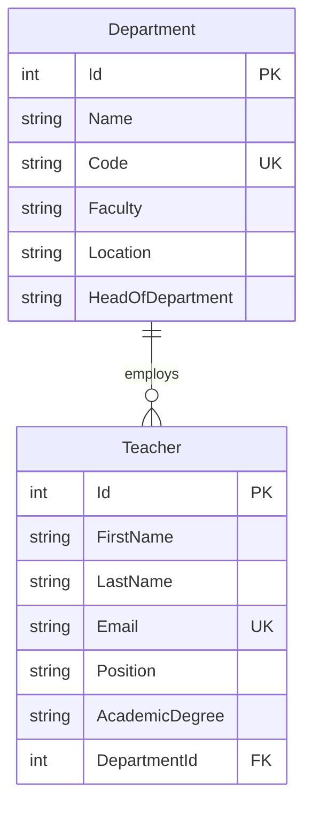

# UniversityDbApp

**Автор:** Alua · **Зертханалық жұмыс:** 3-апта

UniversityDbApp — университет кафедралары мен оқытушыларын басқаруға арналған ASP.NET Core MVC веб-қосымшасы. CampusFlow интерфейсі кафедралар, оқытушылар, аналитика және академиялық құрылымды бір кеңістікте көрсетеді.

## Технологиялар

- .NET 10, C# 14, ASP.NET Core MVC
- Entity Framework Core 10, SQL Server, Code-First migrations
- Razor Views, Bootstrap 5, Bootstrap Icons, Chart.js

## ORM, EF Core және Code-First

ORM (Object-Relational Mapping) — бағдарламадағы объектілер мен реляциялық дерекқор кестелерінің арасындағы сәйкестікті басқаратын тәсіл. Entity Framework Core — .NET-ке арналған ORM. Code-First тәсілінде алдымен C# модельдері анықталады; EF Core миграциялары сол модельдер негізінде SQL Server сызбасын жасайды.

`AppDbContext` — қосымшаның дерекқормен жұмыс істеу шекарасы. Ол `DbSet<Department>` және `DbSet<Teacher>` жиындарын, бірегей индекстерді және кафедра мен оқытушы арасындағы байланысты конфигурациялайды.

## Деректер моделі

`Department` кафедра атауын, бірегей кодын, факультетін, орналасқан жерін және басқа метадеректерді сақтайды. `Teacher` оқытушының аты-жөнін, бірегей электрондық поштасын, лауазымын және академиялық ақпаратын сақтайды.

Бір кафедрада бірнеше оқытушы болады. Әр оқытушы міндетті түрде бір кафедраға тиесілі. `Teacher.DepartmentId` — сыртқы кілт. Кафедраны жою кезінде байланысқан оқытушыларды каскадпен өшірмес үшін жою шектеледі.



## SQL Server-ге қосылу

Әдепкі қосылу жолы `appsettings.json` ішінде берілген:

```text
Server=localhost;Database=UniversityDb;Trusted_Connection=True;MultipleActiveResultSets=true;TrustServerCertificate=True
```

SQL Server Express үшін сервер атауын `localhost\\SQLEXPRESS` етіп өзгертіңіз. LocalDB қолдансаңыз, `Server=(localdb)\\MSSQLLocalDB;Database=UniversityDb;Trusted_Connection=True;MultipleActiveResultSets=true;TrustServerCertificate=True` жолын пайдаланыңыз. Қажет болса, жергілікті ортаңызға сай қосылу жолын `appsettings.Development.json` файлына орналастырыңыз.

## Орнату және іске қосу

Visual Studio 2026 немесе .NET 10 SDK, SQL Server (Express/Developer) және SQL Server Management Studio орнатыңыз. Репозиторий каталогында:

```powershell
dotnet restore
dotnet tool install --global dotnet-ef --version 10.0.0
dotnet ef database update
dotnet run
```

`InitialDb` және `RepairLegacyCampusSchema` миграциялары репозиторийге енгізілген. Сондықтан оларды қайтадан `migrations add` пәрменімен жасамаңыз. Модельді кейін өзгерткенде ғана жаңа миграция жасаңыз, мысалы `dotnet ef migrations add AddNewField`.

Visual Studio Package Manager Console баламасы:

```powershell
Update-Database
```

Миграциядан кейін SSMS Object Explorer ішінде `UniversityDb > Tables` тармағын жаңартыңыз. `dbo.Departments`, `dbo.Teachers` және `dbo.__EFMigrationsHistory` кестелері көрінуі керек. `Teachers.DepartmentId` сыртқы кілті `Departments.Id` бағанына сілтейді.

Development ортасында дерекқорға қосылып, миграциялар қолданылғаннан кейін алты кафедра және әр кафедраға арналған демонстрациялық оқытушылар автоматты түрде қосылады. Кестелерде дерек бар болса, қайтадан seed орындалмайды.

## Мүмкіндіктер

- Кафедралар мен оқытушыларға арналған толық CRUD, серверлік/client-side validation және жою алдындағы растау беттері
- Іздеу, сүзгілеу, сұрыптау және беттеу
- Дерекқордағы нақты мәндерден жиналатын басқару панелі мен Campus Insights диаграммалары
- Факультет → кафедра → оқытушы академиялық құрылым көрінісі
- Басып шығаруға ыңғайлы есептер, ашық/қараңғы тақырып және мобильді навигация
- Anti-forgery қорғанысы, асинхронды EF Core сұраулары және құрылымды логтау

## GitHub-қа жариялау

```powershell
git init
git add .
git commit -m "Build UniversityDbApp campus workspace"
git branch -M main
git remote add origin https://github.com/<username>/UniversityDbApp.git
git push -u origin main
```

Жоба атауы `UniversityDbApp`. GitHub репозиторийі жасалғанда дәл осы атауды пайдаланыңыз. `bin/`, `obj/`, `.vs/`, жергілікті құпия файлдар және SQL Server дерекқор файлдары `.gitignore` арқылы еленбейді.

## Скриншоттар

SSMS ішінде кестелерді көрсететін скриншотты және қосымшаның Overview, Departments, Teachers, Campus Insights беттерінің скриншоттарын `docs/screenshots/` ішіне сақтаңыз. Скриншоттарды жасағаннан кейін README-ге Markdown сурет сілтемелерін қосыңыз. Бұл каталогқа әзірге нақты скриншот файлдары қосылмаған.
